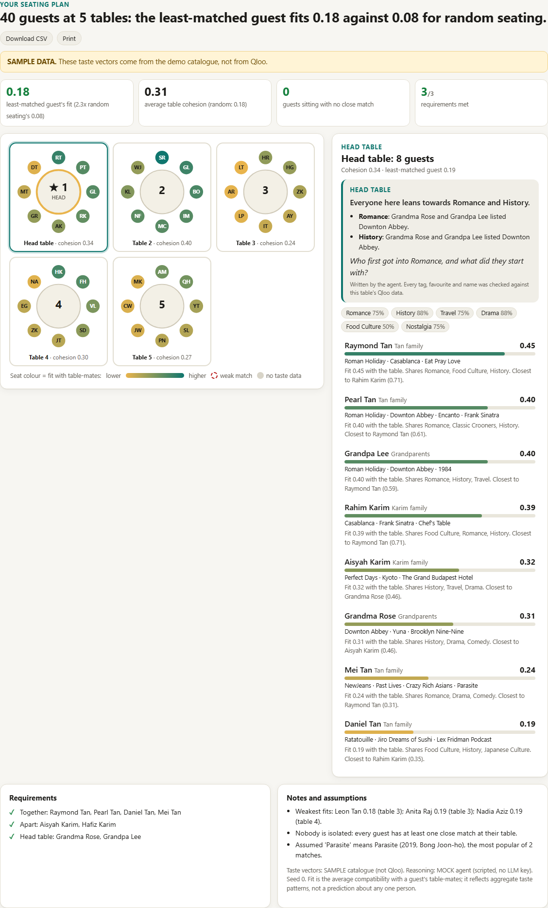
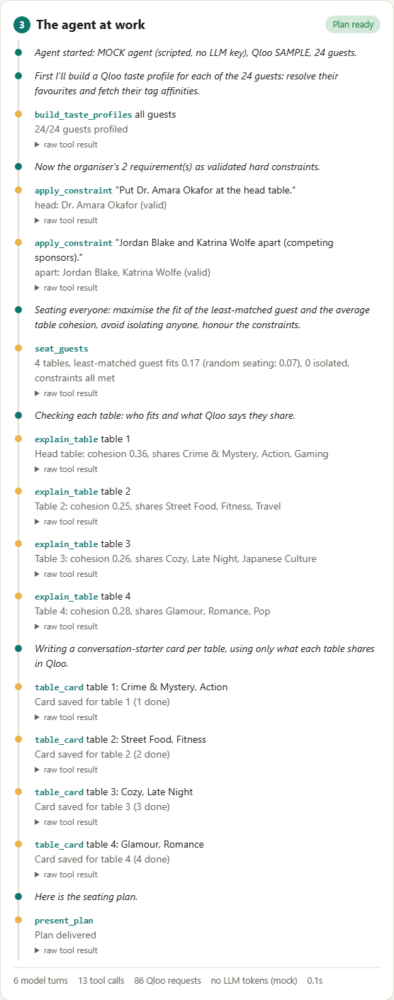
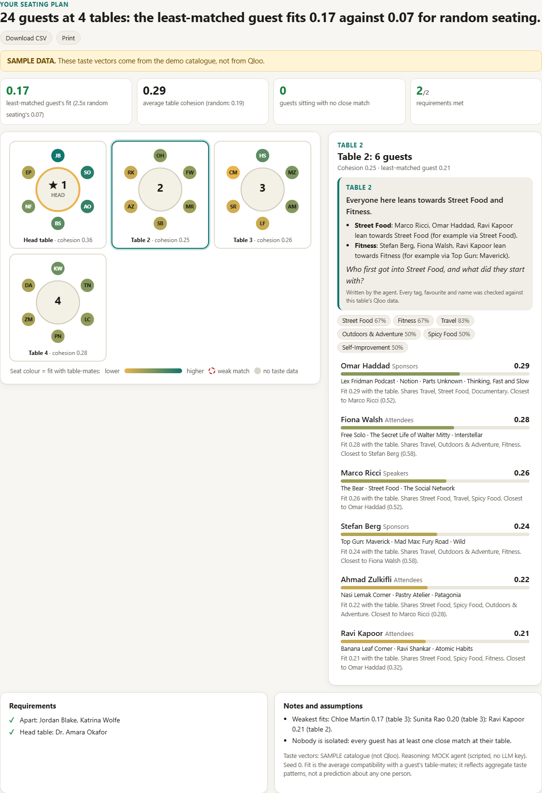
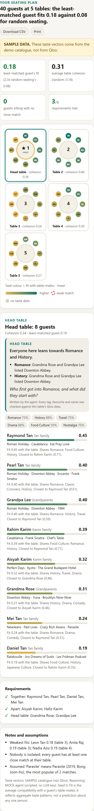

# Placecard

**Seat every table with people who will actually talk.** Placecard is an AI agent that builds the seating chart for a wedding, a conference dinner or any big table plan. Each guest gives two to four favourites (films, music, books, restaurants, shows). The agent reads their taste through **Qloo's cultural taste graph**, seats the room so each table shares real common ground and **nobody is stuck with only strangers**, honours the organiser's requirements ("keep the Tans together", "Dave and Ali apart", "Grandma at the head table"), and writes a grounded conversation-starter card for every table. Every step it takes is shown live.

Built for the [Qloo Agentic Hackathon](https://qloo.devpost.com/). MIT licensed.



> **Data honesty.** If no Qloo key is set, the app runs on a hand-written **SAMPLE** catalogue (real public titles, invented places, hand-written tags). The UI shows a SAMPLE banner and the API returns `sample_data: true`. If no LLM key is set, a scripted **MOCK agent** drives the same tools through the same loop, and the UI labels it. **Live Qloo mode has been run against the real hackathon API** (2026-10-06): see [TUNING.md](TUNING.md) for what it returns, the numbers measured on a 40-guest wedding and a 24-guest conference dinner, and the changes that followed. The code was written with AI assistance (Claude Code).

## What it does

1. **Guests.** Paste a list (`Name: favourite; favourite; favourite [Group]`) or upload a CSV (`name, favourites, group`), up to 120 guests. Two presets ship with it: a 40-guest wedding and a 24-guest conference dinner.
2. **Requirements.** Plain-language lines in a box. The agent turns each into a validated hard constraint: together (guests or a whole group), apart, spread (a group divided across the tables, e.g. "speakers across tables"), fixed table, head table. The server refuses to seat until the agent has applied every requirement (or said there is none), and anything not applied is flagged "NOT applied" in the plan.
3. **The agent works.** Taste profiles from Qloo, constraint validation, the optimiser, then a card per table.
4. **The table map.** Round tables, seats coloured by each guest's fit, a dashed ring on anyone with a weak match. Click a table for its card, its shared Qloo tags and each guest's fit and why. Click a seat to jump to that guest. Download the seating as CSV.

| The agent at work | A conference dinner, table selected | On a phone |
|---|---|---|
|  |  |  |

## How Qloo is used

| Step | Qloo endpoint | Purpose |
|---|---|---|
| Resolve favourites | `GET /search` (nine culture types, comma list) | Each favourite becomes an entity id. Exact name, then the name before a subtitle, then the closest spelling; venues are discounted; a hint such as `Hades (game)` picks the type. Genuinely ambiguous titles (two films called *Oldboy*) become a stated assumption. The response also carries the entity's own tags (up to about 320). |
| Taste profile | `GET /v2/insights` with `filter.type=urn:tag` and `signal.interests.entities` (Qloo "taste analysis") | One call per guest returns the tags that characterise their favourites. Venue and price metadata tags are dropped. |

Everything after that is Placecard's own: each guest's vector is the taste-analysis tags plus their favourites' own Qloo tags (weight 2, mood tags half); pairwise compatibility is the cosine similarity of idf-weighted vectors (a tag everyone has, like "Drama", counts for less than "Korean Cinema"), calibrated so the party's 90th-percentile pair scores 0.6; the tags a table shares **and its guests' own favourites carry** drive the cards. Cost on a cold cache is about 3.6 requests per guest (40 guests: 143 requests, 24 guests: 89), all cached for 24 hours; the hackathon key allows 5 requests per second (Placecard sends 4) and 10,000 per month (the app stops 100 short and `/api/health` shows the remainder). Guest names are never sent to Qloo.

## The seating optimiser (`placecard/seating.py`)

Pure Python, deterministic for a seed, no LLM arithmetic.

- **Scores:** pairwise compatibility is calibrated (`seating.calibrate`): live Qloo vectors give cosines of only 0.02-0.2, so every pair is scaled by one factor that puts the party's 90th-percentile pair at 0.6. Order is unchanged; it keeps the fit terms comparable with the isolation penalty and makes the numbers readable (TUNING.md). SAMPLE vectors already score high enough and are left alone.
- **Objective:** `0.6 * min_fit + 0.4 * avg_cohesion - isolated_fraction`. `fit(g)` is a guest's mean compatibility with their table-mates, `cohesion(t)` the table's mean pairwise compatibility. Maximising the minimum means the worst-matched guest is protected, not just the average.
- **Isolation guarantee where possible.** A guest is "isolated" if nobody at their table is above the party's 70th-percentile pair compatibility. The objective penalises it, and a guest for whom no such company exists anywhere in the party is reported as unavoidable instead of dragging others down.
- **Hard constraints:** together (blocks that are never split), apart, spread (a group of n guests gets at most ceil(n / tables) per table), fixed table, head table. Contradictions (together and apart; five people together at tables of four; two apart guests fixed to one table) are rejected with a clear message when added.
- **Search:** farthest-first greedy start, then a swap/move local search that evaluates candidates incrementally (O(table size) each), worst-fit guests first, with seeded restarts. 120 guests with constraints seat in about half a second.
- **Reports:** per guest fit, closest mate and shared tags; per table cohesion and shared tags; the least-matched guest compared with random seating; an isolation list; a constraint report.

## What makes it agentic

An LLM (Claude or Gemini) gets seven tools and decides which to call, in what order, and when to stop:

| Tool | What it does |
|---|---|
| `build_taste_profiles` | Resolve favourites with `/search`, fetch each guest's tag vector (taste analysis) and blend in the favourites' own tags. Batches of 60, 6 threads on the live API (throttled to 4 requests per second, 429s retried), reports unmatched favourites and ambiguity assumptions. |
| `apply_constraint` | One requirement becomes a structured constraint. Guest names and groups are resolved (unique first names and "the Tans" work), then the whole set is validated before anything is stored. |
| `seat_guests` | Run the optimiser (refused while the organiser's requirements are still unapplied). Returns tables, lowest-fit guests, isolation checks and the constraint report. |
| `explain_table` | Grounded detail for one table: each guest's fit and why, the shared Qloo tags, and the favourites behind them. |
| `table_card` | Save a conversation-starter card. **The server rejects any card that names a tag, favourite or guest that is not grounded in that table's own Qloo data**, including casual mentions in the free text: a topic must be a tag the table shares and be backed by favourites that themselves carry it, and a card may not borrow another table's distinctive tag (a tag common to three or more tables is an everyday word, not a claim). |
| `ask_organizer` | Ask one clarifying question (for example when a third of the guests have no matched favourites). The UI shows it and re-runs with the answer. |
| `present_plan` | Finish. Requires a fresh seating; any table without a card gets an automatic grounded one. |

The loop (`placecard/agent.py`) is provider-neutral and has a turn limit, a per-run Qloo call budget, one nudge when the model replies without a tool call, a guard that refuses calls after the final tool, and a fallback that assembles the plan from the tools' results if the model stops early.

## Run locally (Python 3.10+)

```bash
python -m placecard.server                  # http://localhost:8000  (MOCK agent + SAMPLE data, no keys)
python -m unittest discover -s tests -v     # 202 tests, no network (live API shapes come from tests/fixtures/)
```

Open `/#run=wedding` or `/#run=conference` to start a demo run automatically. With a Qloo key the preset buttons load the live lists (real titles, with a strong Malaysian and wider Asian share); without one they load the SAMPLE lists.

Check quality against the real API (needs `QLOO_API_KEY`; prints no keys, caches Qloo results in `.cache/`):

```bash
python scripts/live_eval.py check               # does every favourite in the live presets resolve?
python scripts/live_eval.py wedding --sweep     # vectors, separation, seating and a parameter sweep
python scripts/live_run.py wedding --llm mock   # the whole agent (--llm gemini | anthropic for a real model)
```

To use real services, put keys in the environment only. Never put them in code or commit them:

```bash
pip install -r requirements.txt             # only needed for Claude
export QLOO_API_KEY=...                      # hackathon key; works only on https://hackathon.api.qloo.com
export GEMINI_API_KEY=...                    # Google AI Studio key (free tier), or:
export ANTHROPIC_API_KEY=...                 # Anthropic Console key
export LLM_PROVIDER=gemini                   # auto | mock | gemini | anthropic
python -m placecard.server
```

See `.env.example` for every setting, including the abuse limits for a public demo (`RUNS_PER_IP_PER_HOUR`, `RUNS_PER_DAY`, `MAX_QLOO_CALLS`, `MAX_GUESTS`).

| Setting | Default | Notes |
|---|---|---|
| `GEMINI_MODEL` | `gemini-3.5-flash` | Any Gemini model that supports function calling (see `../BAKEOFF.md`; the free tier has a daily request cap per model, `gemini-3.1-flash-lite` has a separate one) |
| `OWN_TAG_WEIGHT` | `2.0` | Weight of the favourites' own Qloo tags next to the taste-analysis tags; `0` = taste analysis only |
| `QLOO_RPS`, `QLOO_MONTH_RESERVE` | `4`, `100` | Requests per second to Qloo (the key allows 5); stop spending when this many of the 10,000 monthly requests remain |
| `QLOO_CACHE_FILE` | unset | Keep Qloo results across restarts (a local JSON file) |
| `ANTHROPIC_MODEL` | `claude-haiku-4-5` | e.g. `claude-sonnet-5-5` for higher quality at higher cost |

## API

- `GET /api/health` returns which modes are active and, once a run has called Qloo, `qloo_quota` (the last known monthly remainder from Qloo's headers). It never returns keys and never calls Qloo.
- `GET /api/presets` returns the guest lists: real titles with a live Qloo key, the SAMPLE lists otherwise.
- `POST /api/plan` takes `{guests:[{name,favorites[],group}], table_size, constraints_text, clarifications[], seed}` and returns the full result.
- `POST /api/plan/stream` does the same but streams newline-delimited JSON: one `{"event":...}` per agent step (including `progress` events while profiles build), then a final `{"result":...}`.

## Layout

```
placecard/
  agent.py        LLM tool-calling loop, system prompt, input validation
  tools.py        seven tools + schemas (grounding checks, requirements guard, budget, cards, fallback)
  requirements.py notes -> sentences -> constraint arguments (MOCK agent and outage fallback)
  seating.py      compatibility, constraints, optimiser, isolation checks, shared tags
  qloo.py         live Qloo client (GET, X-Api-Key, throttle, retries, cache, search + taste analysis, own-tag blend)
  sample_qloo.py  SAMPLE catalogue with the same interface (no key needed)
  presets.py      guest lists: SAMPLE ones (keyless) and live ones with real, resolvable titles
  llm/            provider abstraction: anthropic_llm.py, gemini_llm.py, mock_llm.py
  server.py       stdlib HTTP server, NDJSON streaming, rate limiting
static/           single-page UI (no framework)
tests/            unit and HTTP tests (maths, constraints, isolation, brute-force optimality, speed, grounding, live API shapes)
tests/fixtures/   trimmed real Qloo responses (search, taste analysis, a 400, rate-limit headers; no keys)
scripts/          live_eval.py (quality on the real API), live_run.py (full agent run)
TUNING.md         what the live API returns and the numbers behind each tuning change
docs/             screenshots
```

## Deploy

See [DEPLOY.md](DEPLOY.md). Render's free web service is the recommended host (`render.yaml` included). A `Dockerfile` is provided for any container host.

## Privacy and responsible use

Only favourite titles and entity ids are sent to Qloo. Guest names stay on the server and go only to the LLM provider. The LLM receives the guest list by name and group, not their favourites; it sees favourites only through tool results (for example `explain_table`). Ask organisers to use first names or nicknames. As Qloo's own guidance says, an affinity describes aggregate taste patterns, not a fact or prediction about any individual; the UI says so and the cards are phrased that way.
